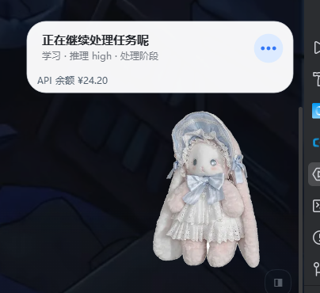

# 月御姬 · DSH 桌宠

> 为 [DeepSeek Harness](https://github.com/deepseek-ai/deepseek-harness) 桌面端准备的桌宠角色包：
> 在 `dsh-dafeiyu`（大肥鱼）底座上替换角色素材并打一组定制补丁，得到一只名为**小月姬**的原生桌宠。



## 特性

- **原生窗口**：透明、无边框、始终置顶，不进任务栏、点击不抢焦点（`TOPMOST` + `TOOLWINDOW` + `LAYERED`），可拖动并记忆位置
- **免重编译换角色**：角色完全数据驱动（`pet-manifest.json` + 逐帧 WebP），替换素材即可换人
- **微信「有人找你」提醒**：监视微信桌面版消息库写入，冒泡提示并保持 20 秒，不碰微信协议
- **空闲心跳**：顶掉底座里写死的兜底文案，空闲时显示小月姬自己的台词
- **余额阈值联动**：余额低于阈值时切 ERROR 状态（垂头）+「我没力气了」
- **文案统一**：气泡、设置页标题/开关、底层错误提示全部改为「小月姬」

## 快速开始

> 前提：Windows 10/11 x64；已安装 DeepSeek Harness 桌面版；已在应用内安装并启用 `dsh-dafeiyu@0.1.23`。

```powershell
git clone https://github.com/<your-name>/yueyuji-pet.git
cd yueyuji-pet
powershell -ExecutionPolicy Bypass -File .\tools\apply.ps1
```

然后**完全退出并重新打开** DeepSeek Harness。

验证：

```powershell
powershell -ExecutionPolicy Bypass -File .\tools\verify.ps1
```

回滚：

```powershell
powershell -ExecutionPolicy Bypass -File .\tools\apply.ps1 -Revert
```

详细步骤见 [docs/INSTALL.md](docs/INSTALL.md)。

## 目录结构

```
assets/
  pet-manifest.json          角色清单：16 组动作、帧表、状态映射表
  pet/<clip>/*.webp          165 帧、412×344、每帧独立 WebP
  character-base.png         合成用母版（412×344，透明）
patches/
  inject-block.js            注入 plugin.js 的主代码块（余额阈值 / 微信库监视 / 通知粘滞与恢复）
  inject-heartbeat.js        注入 plugin.js 的空闲心跳
tools/
  apply.ps1                  安装 / 回滚（锚点补丁 + 部署素材，无需 git/Python）
  verify.ps1                 安装后自检
  build_assets.py            从一张透明底立绘重新生成全部帧与 manifest
docs/
  INSTALL.md                 安装与回滚细节
  ARCHITECTURE.md            实现原理与数据流
  TROUBLESHOOTING.md         常见问题
  ROADMAP.md                 打包成独立插件的计划
```

## 原理（简版）

1. `dsh-dafeiyu` 的原生角色由 PyInstaller 打包的 Helper 渲染，Helper **从自己旁边的 `assets/` 读取清单与帧**，因此换角色不需要重新编译。
2. 首次启动时 Helper 会把包内 `assets/` 复制到 `%LOCALAPPDATA%\dsh-dafeiyu\<version>\assets\`，**仅当该目录缺少 `pet-manifest.json` 时才复制**——这给了我们一个稳定的覆盖点。
3. 定制逻辑全部通过补丁注入插件的 JS（`src/plugin.js` 等），走 Host 与 Helper 之间既有的 `state` / `tasks` 消息协议，**没有改动任何私有协议格式**。

详见 [docs/ARCHITECTURE.md](docs/ARCHITECTURE.md)。

## 已知限制

| 限制 | 说明 |
| --- | --- |
| 微信提醒分不清收发 | 依据消息库写入判定；安静 45 秒后你主动发消息也可能触发一次 |
| 只能看到「发给你」的消息 | 微信桌面版消息库包含私聊；Bot 桥接（`dsh-channel-wechat`）只能看到发给机器人的消息 |
| 两处文案改不动 | 窗口标题与空闲兜底文案编译在 `helper.exe` 里，需重编译 PySide6 Helper 才能改 |
| 升级会覆盖 | `dsh-dafeiyu` 升级后补丁被覆盖，重跑 `apply.ps1` 即可恢复 |
| 无「点一下关闭」 | 气泡点击事件在 Python Helper 内，Host 侧收不到；只能按时间自动消失 |

## 许可

- 本仓库的脚本与文档：[MIT](LICENSE)
- 角色素材：由仓库所有者提供的实物照片处理而来，版权归其权利人；**请勿在未获授权时二次分发角色形象**
- `dsh-dafeiyu`：本仓库不包含其源码，仅以补丁形式分发修改；使用前请阅读上游许可（见 [NOTICE.md](NOTICE.md)）

## Roadmap

见 [docs/ROADMAP.md](docs/ROADMAP.md)：目标是把它做成**一个独立 DSH 插件**（不依赖打补丁），当前先以「素材包 + 补丁安装器」形式交付。
